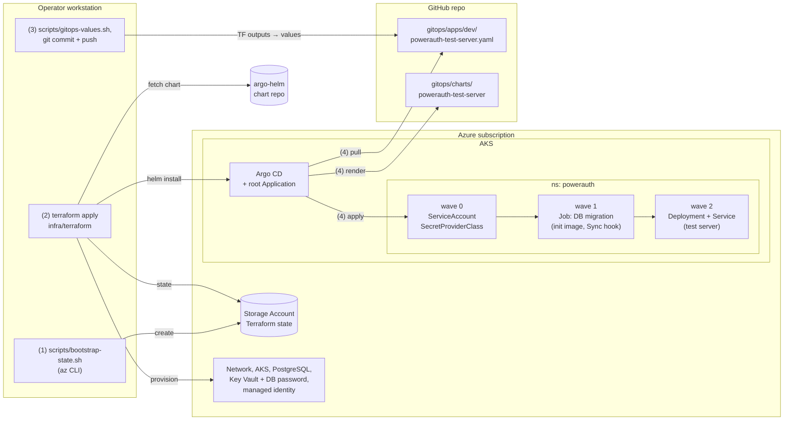
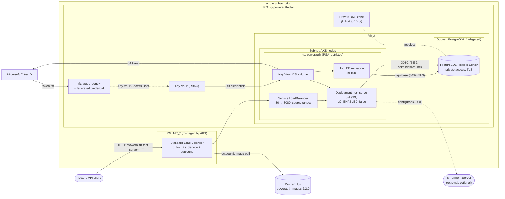

# PowerAuth Test Server on Azure

Infrastructure for running [powerauth-test-server](https://github.com/wultra/powerauth-tests/tree/develop/powerauth-test-server) on Azure, provisioned by Terraform and deployed by Argo CD.

- **What:** AKS, PostgreSQL Flexible Server (private), Key Vault and Argo CD, created by one Terraform root module.
- **GitOps:** Argo CD pulls this repository and deploys a Helm chart; no pipeline is involved. A new version is a commit changing `image.tag`.
- **Migrations:** the vendor init image runs as a Job before every rollout; a failed migration stops the rollout.
- **Secrets:** the DB password is generated by Terraform straight into Key Vault and mounted through workload identity. It is not in Git or in the Terraform state.
- **Deploy:** two scripts and one `terraform apply`, see [Deploy to Azure](#deploy-to-azure).

## Architecture

### Provisioning and GitOps



### Runtime



## Repository layout

```
infra/terraform/          Azure infrastructure + Argo CD bootstrap (single root module)
gitops/apps/<env>/        Argo CD Applications of one environment
gitops/charts/            Helm chart of the test server
scripts/                  bootstrap-state.sh, gitops-values.sh
```

## Deploy to Azure

Prerequisites:

- Owner, or Contributor + Role Based Access Control Administrator, on the subscription.
- Your own copy of the repository: Argo CD pulls `gitops_repo_url` (branch `master`) without credentials, so fork it and set `gitops_repo_url` in `dev.tfvars`.
- A region open for the subscription (Free Trial subscriptions are restricted, e.g. in West Europe): `az postgres flexible-server list-skus -l austriaeast` and `az vm list-skus -l austriaeast --size Standard_D2s_v6`.

```shell
az login
export ARM_SUBSCRIPTION_ID="$(az account show --query id -o tsv)"

# 1. Terraform state storage (once)
./scripts/bootstrap-state.sh

# 2. Infrastructure + Argo CD; only admin_ip_ranges may reach the API server and Key Vault
export TF_VAR_admin_ip_ranges="[\"$(curl -4 -fsS https://ifconfig.me)/32\"]"
terraform -chdir=infra/terraform init -backend-config=backend.hcl -backend-config="key=powerauth-dev.tfstate"
terraform -chdir=infra/terraform apply -var-file=dev.tfvars

# 3. Hand-off to GitOps: who may reach the application, then commit and push
./scripts/gitops-values.sh "$(curl -4 -fsS https://ifconfig.me)/32"
git commit -am "Configure dev environment" && git push
```

The values committed in `gitops/apps/dev/` belong to the previous deployment, so the first sync succeeds only after step 3; a sync started before the push can be terminated in the Argo CD UI.

## Day-2 operations

- **New version:** change `image.tag` in `gitops/apps/dev/powerauth-test-server.yaml`, commit, push. The migration Job uses the same tag and runs first.
- **Failed migration:** the sync stops and Argo CD does not retry the same commit once its retries are used up. Check `kubectl -n powerauth logs job/powerauth-test-server-migration`, then push a fix or sync manually.
- **Rotate the DB password:** increment `db_password_version`, apply, and restart the Deployment after the CSI driver has refreshed the Secret (2 minutes).
- **Operator IP changed:** `plan` fails on refresh because Key Vault and the API server reject the new address. Update the allowlists first: `terraform -chdir=infra/terraform plan -refresh=false -var-file=dev.tfvars -target=azurerm_key_vault.main -target=azurerm_kubernetes_cluster.main -out=ip.tfplan`, then `apply ip.tfplan`.
- **New environment:** add `test.tfvars`, copy `gitops/apps/dev` to `gitops/apps/test`, run `init -reconfigure` with `key=powerauth-test.tfstate`, apply, then run `gitops-values.sh`.
- **Tear down:** `terraform -chdir=infra/terraform destroy -var-file=dev.tfvars`, then `az group delete --name rg-powerauth-tfstate`. After `az aks stop`, run `az aks start` before the next `plan` or `destroy`.

## Design decisions

| Decision | Why | Alternative |
|---|---|---|
| AKS + Argo CD | Pull-based GitOps needs no pipeline (out of scope) | |
| Migration Job from the init image | Schema changes are gated before the rollout; the app runs with `LQ_ENABLED=false` and Hibernate `validate` | Liquibase on application start |
| Argo `Sync` hook in wave 1 | `PreSync` would run before the ServiceAccount and SecretProviderClass exist | Plain sync waves (the Job would not re-run on upgrades) |
| Key Vault + CSI driver + workload identity | No DB credential in Git, Terraform state or pod specs; managed AKS add-on | External Secrets Operator |
| Ephemeral password + write-only attributes | The DB password never lands in the Terraform state | `random_password` resource |
| `LoadBalancer` Service with source ranges | One service and no TLS requirement; the AKS NGINX add-on is supported only until November 2026 | Gateway API once there are more services or TLS |
| API server and Key Vault restricted to `admin_ip_ranges` | Least exposure without a jump host or VPN | Private cluster + private endpoints |
| Terraform outputs reach Git through `gitops-values.sh` and a reviewed commit | Git stays the only source of the environment configuration; no pipeline | Commit from a pipeline, or GitOps Bridge (cluster metadata read by an ApplicationSet) with more clusters |
| One repository, one Terraform root module | One environment; Argo CD is bootstrapped by the same `apply` | Separate GitOps repository and bootstrap stack as the platform grows |
